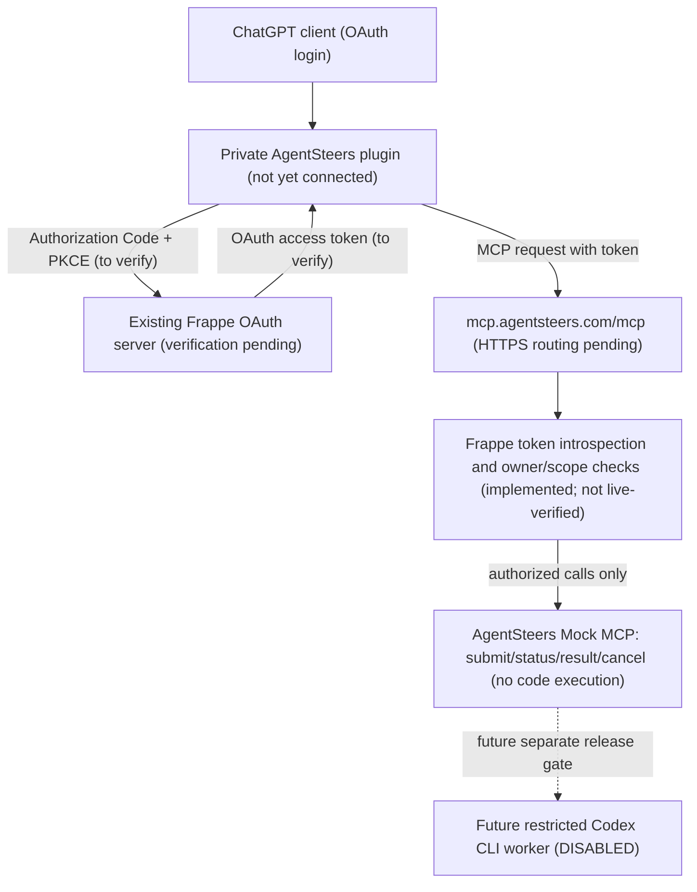

# AgentSteers

### Frappe OAuth MCP testing commands (not yet publicly routed)

- `make mcp-auth-check`: automatically sets `AGENTSTEERS_FRAPPE_OAUTH_ENABLED=1` and defaults `AGENTSTEERS_FRAPPE_ISSUER` to `https://agentsteers.com` (the configured production Frappe site), unless explicitly overridden; checks other required settings without network calls or printing credentials.
- `make mcp-auth`: use the same automatic OAuth enablement and default issuer, validate configuration, and start the **separate loopback-only** Frappe OAuth Mock MCP listener on `127.0.0.1:8767`, using a single Gunicorn worker. It does not edit Caddy or enable Codex.
- `make mcp`: unchanged temporary **static Bearer** Mock MCP test session; it is **not** Frappe OAuth.
- `make mcp-mock-test`: offline test modules, including Frappe introspection tests.

The default issuer is based on the repository production site configuration, **not proof that Frappe OAuth issuer metadata is live or compatible**. Override it privately with `AGENTSTEERS_FRAPPE_ISSUER=https://your-real-issuer` if the deployed issuer differs. The remaining environment is supplied **privately on the host**: `AGENTSTEERS_FRAPPE_OAUTH_ENABLED=1`, `AGENTSTEERS_FRAPPE_ISSUER`, `AGENTSTEERS_FRAPPE_CLIENT_ID`, `AGENTSTEERS_FRAPPE_CLIENT_SECRET`, `AGENTSTEERS_FRAPPE_SUBJECTS`, `AGENTSTEERS_FRAPPE_REPOS`, and `AGENTSTEERS_FRAPPE_MCP_RESOURCE=https://mcp.agentsteers.com/mcp`. Configuration checks are structural only; real Frappe issuer, introspection response claims, Client registration/PKCE and live OAuth login **remain unverified**. Do not expose this listener publicly until the installed Frappe release and token claims are confirmed. Never paste or commit credentials.

## Authentication decision (2026-11-10): use the existing Frappe OAuth provider

**Chosen path: Frappe OAuth for AgentSteers' ChatGPT-to-MCP login during development/testing.** Reuse the existing Frappe deployment and its user accounts. **Do not deploy Keycloak or Cloudflare Access for this path**; previously added Keycloak Compose and configuration guides are retained as inactive, optional reference material only. The earlier Keycloak recommendation is superseded by this decision.

Target flow: **ChatGPT OAuth client → existing Frappe authorization server → AgentSteers OAuth-protected Mock MCP** at `https://mcp.agentsteers.com/mcp`. Keep `make mcp`'s static-Bearer Mock route unchanged until OAuth end-to-end testing succeeds; keep real Codex execution disabled.

**Implementation gap (not a live integration):** Frappe's actual release and OAuth provider endpoints, authorization-code + PKCE S256 behavior, redirect URI registration, server discovery metadata and ChatGPT client-registration compatibility must be verified on the installed instance. Determine whether Frappe emits a signed JWT *access token* with issuer/JWKS/audience claims or an opaque access token. The current `AccessTokenVerifier` and `oauth_mock_wsgi.py` require JWT/JWKS and **cannot be presumed compatible with Frappe-issued tokens**. For opaque tokens, implement a server-side Frappe token introspection/validation adapter using protected server credentials, strict issuer/active-client/resource/audience checks where supported, a locally enforced repository allowlist, and server-side ownership authorization. Do not treat a Frappe login cookie, API key, or ID token as an MCP OAuth access token. If Frappe does not support a required ChatGPT OAuth feature natively, build a narrowly scoped compatibility bridge rather than exposing admin credentials.

Required acceptance: real Frappe login via ChatGPT web, metadata and PKCE verification, rejection of missing/invalid/expired credentials, scoped mock tool calls (`agentsteers:read`, `agentsteers:submit`, `agentsteers:cancel`), and cross-user task isolation. **No Frappe OAuth login, server deployment, token issuance, or ChatGPT integration is claimed verified yet.** Keep OAuth secrets in private server configuration, never in GitHub or chat.


### Historical alternative: Keycloak authorization-server preparation (not selected)

A test-environment setup runbook is available at [docs/oauth-authorization-server.md](docs/oauth-authorization-server.md). This older document describes a separate OAuth provider (Keycloak); the current decision is to reuse Frappe instead for Authorization Code + PKCE S256, client registration, access-token audience `https://mcp.agentsteers.com/mcp`, and the three Mock MCP scopes. `scripts/check_oauth_metadata.py` checks a locally saved, non-secret authorization-server discovery JSON for issuer, HTTPS endpoints, S256 and selected client mode; `tests/test_oauth_metadata.py` contains negative cases. **This is preparation, not an installed authorization server or a connected ChatGPT plugin.** Do not put login credentials or tokens into the repository.


### Default-off OAuth WSGI configuration (prototype only)

`src/agentsteers/oauth_mock_wsgi.py` is now a separate WSGI entrypoint; it is **not connected to Caddy** or the running `make mcp` test session. The application returns HTTP 503 unless `AGENTSTEERS_OAUTH_MOCK_ENABLED=1` and all server-only settings are present: `AGENTSTEERS_OAUTH_ISSUER`, `AGENTSTEERS_OAUTH_AUDIENCE` (must exactly equal `https://mcp.agentsteers.com/mcp`), `AGENTSTEERS_OAUTH_JWKS_URL`, `AGENTSTEERS_OAUTH_AUTHORIZATION_SERVER`, `AGENTSTEERS_OAUTH_SUBJECTS` and `AGENTSTEERS_OAUTH_REPOS`. The URLs must point to a **real configured OAuth provider**, not an example domain. No secrets or access tokens belong in Git. A real authorization-code/PKCE login, trusted proxy routing and live ChatGPT client verification are still pending. Standalone OAuth WSGI tests are in `tests/test_oauth_mock_wsgi.py`.


## OAuth Mock MCP development — 2026-11-10

A separate **opt-in OAuth resource-server application** now exists at `src/agentsteers/oauth_mock_mcp.py`. It uses `create_app(verifier=..., resource=..., authorization_server=..., repositories=...)`, and composes protected-resource discovery, JWT-verifier injection, actor-scoped mock task state, repository allowlisting and required scopes `agentsteers:read`, `agentsteers:submit`, and `agentsteers:cancel`. The four MCP mock tools retain their existing request shapes. The OAuth app never invokes Codex or a shell, and is **not installed in the public reverse proxy** or the legacy bearer-token `make mcp` service. User-supplied OAuth client identifiers, task owner IDs, and approval flags are not trusted.

`tests/test_oauth_mock_mcp.py` exercises protected-resource metadata, unauthenticated challenge, four tools, mock task lifecycle, cross-actor isolation, scope denial, repository allowlisting, HTTPS/Host/Origin checks and unknown-tool rejection using a **fake verifier only**. `make mcp-mock-test` also invokes OAuth discovery and JWT verifier test modules. **No automated test pass is asserted** until tests actually run on the host/CI.

To activate the new OAuth route later, verify the chosen Frappe OAuth provider (or build the necessary compatibility adapter) as an actual OAuth 2.1-compatible authorization server that supports Authorization Code + PKCE, publish real authorization-server metadata, configure a real `AccessTokenVerifier` with trusted issuer/audience/JWKS and an owner-subject allowlist, and intentionally mount the new WSGI app behind a reviewed loopback-only HTTPS proxy. The test authorization server URL is not a deployed service. Authenticate and verify `initialize`, `tools/list`, `submit_task`, `get_task_status`, `get_task_result` and `cancel_task` in ChatGPT web before considering the bridge connected. iPad Voice and actual Codex execution remain separate future milestones.


### Real Codex execution readiness (2026-11-10)

The owner has requested progress toward enabling real Codex CLI tasks and reports that the temporary MCP mock service is operating. **The server status was not independently verified in this GitHub development session.** The public `mock_http_mcp.py` remains mock-only, with no command execution.

`src/agentsteers/codex_readiness.py` now contains a **disabled-by-default** local preflight that rejects root operation, non-allowlisted repositories, unsafe checkout ownership/path, and approvals that do not match a verified actor/task/repository. `tests/test_codex_readiness.py` provides offline negative cases and is included in `make mcp-mock-test`. The module performs **no Codex invocation** and does not enable execution by toggling a public setting.

**Not yet implemented or independently verified:** OAuth-linked actor identity in the public MCP service; durable, expiring, one-time approvals issued by a trusted server workflow; a non-root isolated Codex executor with filesystem/network sandbox, resource limits and cancellation; durable audit logs; secrets isolation; end-to-end tests; authorized server deployment. All of these remain required before real task execution can be enabled. Keep the existing mock public endpoint separate from any eventual real-execution endpoint.


### Rotate the temporary Mock MCP bearer token (`make rotate`)

From the checked-out AgentSteers repository on the authorized **Linux host**, as the **same non-root account** that runs `make mcp`:

```sh
# First stop the running make mcp session (Ctrl+C) and verify the MCP route has been restored.
make rotate
# Then start a new temporary session when ready:
make mcp
```

`make rotate` generates a new random token using Python's `secrets`, atomically replaces `~/.config/agentsteers/mock-mcp.token`, and retains mode `0600` in a private `0700` directory. It never prints the credential, and refuses a symlink, insecure existing file, root execution, or an active/uncertain local Mock MCP listener on `127.0.0.1:8766`. It **does not** restart processes, change Caddy, alter an external credential store, or revoke an old token already held by another service. The operator must ensure all active sessions have stopped; independently configured `AGENTSTEERS_MCP_MOCK_TOKEN` environments and client/plugin credentials must be updated separately. A leaked credential remains unsafe until all services accepting it are stopped or reconfigured.

This rotates only the temporary mock shared token, **not** OAuth credentials. Never paste the replacement token into chat or commit it. Run `make mcp-mock-test` and verify HTTP 401 for revoked credentials before public usage. GitHub commit alone is not a server change.


## ChatGPT plugin / public MCP release gate (2026-11-10)

**Owner direction:** Prepare the mock-only service for a public HTTPS connection at `https://mcp.agentsteers.com/mcp`. This is authorization to pursue a *safe public mock test*, not evidence that deployment occurred or permission to expose Codex, shell, Git write actions, payroll data, or sensitive content.

**Current source status:** The existing `src/agentsteers/mock_http_mcp.py` has four mock task tools protected by one shared bearer token. `oauth_security.py` includes an OAuth JWT verifier, but it is not mounted into the public MCP route. The new `oauth_discovery.py` and `tests/test_oauth_discovery.py` are optional building blocks for protected-resource metadata and tests; they are not wired to the web app, and they do not constitute a complete OAuth authorization flow. The owner reports previous direct HTTP MCP tool tests, including successful cancellation, but this session has not verified public service state, tests, OAuth login, or ChatGPT plugin connection.

**Hard release gate:** A bearer token was previously pasted into chat. Revoke/rotate it using private server-side secrets storage **before** enabling an externally reachable route. Never write the replacement token into git, console logs, chat, or documentation. Validate least-privilege service identity and repository allowlist, TLS, expected Host, mock-only execution, negative authentication cases, request limits, rollback, and website isolation. Do not make the route publicly reachable if any gate fails.

**Preferred ChatGPT path:** Implement a real authorization server using authorization code with PKCE and suitable OAuth client registration, resource/audience binding, metadata, Bearer challenges, server-side access token verification and per-actor task permissions. Keep the legacy static-token mock test logically separate. ChatGPT Work web plugin authentication, OAuth tool discovery and four tool calls must be demonstrated before claiming integration. iPad Voice and remote Codex are later, separate acceptance milestones.

**Deployment is not performed by GitHub commits.** DNS/TLS, secure host configuration, process supervision, proxy changes and live tests require authorized server access and must be reported from actual execution, not inferred from repository state.

Official docs: https://developers.openai.com/api/docs/guides/custom-mcp-server and https://developers.openai.com/plugins/build/auth


**AgentSteers turns ChatGPT Voice Mode on an iPad into a voice control interface for Codex CLI on the owner's cloud server.** The user speaks to ChatGPT, the authorized AgentSteers Plugin relays the task to AgentSteers running on the cloud server, and AgentSteers controls Codex CLI installed **on that same server**. Task progress and results flow back through the Plugin to ChatGPT Voice. AgentSteers is the secure bridge, not another chat assistant.

> **Status (2026-11-08):** The end-to-end Voice Mode → integration → server Codex loop is **not yet implemented or verified**. Local mock-worker experiments do not provide live remote execution.

## Why AgentSteers? (Planned product value)

**Speak to your coding agent, from anywhere — on your own infrastructure.**

AgentSteers is designed for developers who want to issue development requests from **ChatGPT Voice Mode on an iPad** and have a **Codex CLI instance on their own cloud server** carry them out, with progress and results returned to the conversation.

- **Voice-first, not another remote desktop:** ask for a coding task in natural conversation instead of navigating a separate terminal or control dashboard.
- **Self-hosted execution:** keep the development workspace and Codex CLI on a server you control, with AgentSteers as the narrow connection layer.
- **One server, simple path:** the intended `mcp.agentsteers.com` HTTPS/MCP entry point routes directly to AgentSteers and Codex CLI on the same host — no separate relay machine required.
- **Task feedback in conversation:** submit tasks, check progress, retrieve sanitized results, and cancel work without leaving the voice workflow.
- **Controlled automation:** approved repositories and operations, authenticated identity, least-privileged execution, redacted audit trails, and separate approval for dangerous changes.
- **Open-source and extensible by design:** start with Codex CLI; other coding agents may be considered later, but are not supported today.

### How it differs from mobile coding interfaces

Mobile interfaces and remote development tools can already help people manage coding work away from their desks. AgentSteers is **not intended to replace those interfaces**. Its proposed differentiator is the combination of **ordinary ChatGPT voice conversation + private-plugin bridge + self-hosted Codex CLI**, with an auditable permission boundary. This distinction is a **product hypothesis**, not a proven competitive advantage or evidence of demand.

### Why build this instead of only using official Codex tools?

**Official capabilities we acknowledge:** OpenAI's Codex Remote lets people start, steer, review, and approve tasks on connected development machines from the ChatGPT mobile app. Its secure relay can keep those machines reachable without exposing them directly to the public Internet. OpenAI also supports voice-driven coordination with Codex in supported desktop experiences. AgentSteers does **not** claim to have invented remote Codex access, approvals, secure relay, or mobile task monitoring.

**Our narrower hypothesis:** Some developers want an **ordinary ChatGPT Voice conversation on an iPad** to be their primary interface to a **self-hosted Codex CLI** on a server they control, rather than navigating a dedicated Codex Remote UI. AgentSteers aims to provide an open-source, narrowly scoped, auditable bridge for that experience, with a stable `mcp.agentsteers.com` entry point, explicit repository permissions, and conversational task-status feedback. We are not claiming the official product cannot evolve to offer this experience.

| Question | Official Codex experiences | AgentSteers target |
| --- | --- | --- |
| Remote Codex tasks from a mobile device? | Yes, through supported Codex Remote experiences. | Intended, but not yet working. |
| Primary interaction | Official Codex mobile/desktop experiences and supported voice features. | Ordinary ChatGPT Voice conversation on iPad using an authorized plugin. |
| Execution environment | Connected development machines and supported remote environments. | Owner-managed cloud host running AgentSteers and Codex CLI together. |
| Integration model | Official OpenAI Codex ecosystem. | Open-source self-hosted MCP bridge with repo-scoped authorizations. |
| Confirmed iPad Voice → plugin → own server → CLI round-trip? | Not claimed as a universal official workflow. | **Not yet verified**; this is the central prototype milestone. |

**Why invest in it?** To test whether the voice-first, self-hosted workflow saves time and reduces friction for developers away from their keyboards. It is an experiment, not yet a validated user need. Success requires a real iPad end-to-end demo, security validation, and feedback from early users. If official tools already meet a person's needs, they may not need AgentSteers at all.

Sources: [OpenAI — Work with Codex from anywhere](https://openai.com/index/work-with-codex-from-anywhere/), [OpenAI Developers — Mastering remote engineering work](https://developers.openai.com/blog/mastering-codex-remote-for-engineering), [ChatGPT Voice help](https://help.openai.com/en/articles/20001274-chatgpt-voice), [ChatGPT Work and Codex help](https://help.openai.com/en/articles/20001275-chatgpt-work-and-codex).

### Example (target experience, not yet implemented)

> On an iPad: “AgentSteers, ask Codex to review the failing tests in EZ Workbase, fix the bug in a safe branch, and tell me what changed.”

AgentSteers would route an approved, scoped task to the server's local Codex CLI and return status, test results, and a reviewable summary to ChatGPT Voice. **This exact voice-to-Codex end-to-end workflow has not been demonstrated yet.** The current private plugin contains guidance only; local MCP mock tools and tests exist, but live plugin binding, remote authentication, cloud deployment, and Codex execution are pending.

## Proposed architecture

> **Target flow, not yet operational:** iPad Voice Mode → AgentSteers Plugin → AgentSteers on the owner's cloud server → Codex CLI on the same server → results back to Voice Mode. The private plugin and local mock MCP components exist, but no live remote plugin/server/Codex link is deployed.



**Scope and safety:** This is the intended architecture, not a working connection. ChatGPT Voice Mode needs a supported, explicitly connected tool/integration to invoke AgentSteers; voice conversation alone does not grant server access. Require scoped authorization, repository/action allowlists, isolated non-root execution, short-lived credentials, cancellation, and redacted audit logs. The worker must return status/errors/results so ChatGPT can explain them. Code changes can be committed/pushed under the owner's authorized workflow, while production deployment, secrets, and financial operations remain separately gated.


## Intended public endpoint

The future MCP endpoint is **`https://mcp.agentsteers.com/mcp`**, pointing to the owner's cloud server where AgentSteers and Codex CLI will run on the same machine. **The domain registration, DNS, HTTPS endpoint, and service deployment are not yet confirmed or verified.** The [deployment guide](deploy/README.md) includes a fail-closed HTTPS prelaunch configuration and security gates. The existing local development HTTP server must never be exposed to the Internet.

## Domain registration and deployment sequence

The intended public address is **`https://mcp.agentsteers.com/mcp`**. The subdomain is an HTTPS entry point **on the same cloud server** as AgentSteers and Codex CLI, **not a separate relay server**. Domain registration was mentioned as in progress by the owner, **not confirmed complete**.

1. **Register and verify domain:** confirm ownership of `agentsteers.com`. **Pending owner confirmation.**
2. **Choose and authorize server:** obtain its public IP or SSH hostname and appropriate access. **Not provided/verified.**
3. **Configure DNS:** point `mcp.agentsteers.com` to the authorized server, after ownership and address are confirmed. **Not performed.**
4. **Provision HTTPS:** configure TLS reverse proxy with the fail-closed prelaunch site (503, no MCP proxy) from [deployment instructions](deploy/README.md). **Not deployed.**
5. **Implement Google sign-in and MCP OAuth:** Google login proves identity; the MCP resource server separately verifies tokens, audience, allowed actions, and job ownership. **Not connected.**
6. **Deploy authenticated AgentSteers MCP service:** enable the four scoped task operations first against mock jobs, with rate limits and audit logs; do not expose the existing unauthenticated loopback prototype. **Not deployed.**
7. **Connect the existing private AgentSteers Plugin:** bind it to the verified HTTPS MCP endpoint, then verify actual ChatGPT Voice Mode tool invocation on iPad. **Not connected or tested.**
8. **Enable same-server Codex CLI under a restricted worker:** only after the preceding security checks and mock end-to-end tests succeed; keep deployment and sensitive actions separately gated. **Not enabled.**

**Existing deliverables:** the private Plugin (instructions only), four local MCP mock tools, protocol tests, HTTP loopback dev gateway, and prelaunch deployment scaffold are in place. **No live voice → plugin → server → Codex flow is claimed.**

## Proposed components

- **ChatGPT Voice Mode + integration:** voice is the user interface; the connected tool translates a permitted conversation request into an authenticated AgentSteers API call.
- **Control service:** authenticate the caller, check scope/approval, queue tasks, and expose job status and results.
- **Same-server Codex:** AgentSteers runs on the owner's cloud server and uses a restricted local worker to invoke Codex CLI installed on that same machine; no separate execution host is required for the initial design.
- **Feedback loop:** return task output, test summaries, errors, and progress to the integration for ChatGPT to report in conversation.
- **GitHub (optional workflow output):** Codex-produced code changes may result in commits/PRs; GitHub is not the primary control path.

## Security principles

1. **Default deny.** A worker must never execute arbitrary commands or tasks from untrusted input.
2. **Explicit approval.** Every potentially destructive, privileged, or external side effect requires appropriate authorization.
3. **Least privilege and isolation.** Use dedicated non-root identities, restricted filesystem/network access, and short-lived credentials.
4. **No secrets in tasks, logs, or commits.** Store secrets in an approved secret manager, never in source control.
5. **Auditable actions.** Record task identity, approver, scope, timestamps, outcomes, and redacted logs.
6. **Human-controlled deployment.** No automatic production deploys, financial transactions, or access to real payroll data.
7. **Safe cancellation and limits.** Enforce timeouts, resource caps, idempotency, and a kill switch.

## Initial milestones

- [x] Document the intended voice-to-Codex architecture and security boundaries.
- [ ] Define the ChatGPT integration interface and supported invocation mechanism.
- [ ] Specify authenticated task submission, status polling, cancellation and result schemas.
- [ ] Validate local dry-run worker behavior and tests.
- [ ] Implement an isolated server worker with a controlled Codex CLI adapter.
- [ ] Demonstrate end-to-end voice request → approved task → Codex → spoken outcome in a test environment.
- [ ] Complete security review before production server access.

## Relationship to EZ Workbase

EZ Workbase is a separate Frappe-based business application. AgentSteers may eventually help implement and test authorized changes to EZ Workbase, but the two projects should remain isolated. Any payroll or ACH integration must use test data until independently approved and validated.

## Development

Do not treat the mock worker as proof of a working cloud bridge. Develop and test the API contract and permission model locally before enrolling a server or allowing real Codex execution.


### Local development commands (Makefile)

Requires Python 3.11+, `make`, Git, and Python virtual environment support. On CentOS Stream 9, install the interpreter and pip if needed with `sudo dnf install python3.11 python3.11-pip`. From the repository root:

```bash
make help
make install
make dev
```

`make dev` checks that `.venv` uses Python 3.11+ and has pip, attempts `ensurepip` repair, and backs up an incompatible virtual environment as `.venv.backup.*` before recreating it. It does not modify the system Python. It then installs the editable package plus MCP, Uvicorn and JWT dependencies into `.venv`, generates an **ephemeral development bearer token** if `AGENTSTEERS_DEV_TOKEN` is unset, and starts the mock MCP HTTP service **only on `127.0.0.1:8765`**. The local endpoint is `http://127.0.0.1:8765/mcp`. Before launching, `make dev` checks Linux `/proc` for an existing listener on port `8765`. It sends SIGTERM **only** if that listener is a same-user `python -m agentsteers.http_server` process running from this repository directory. It waits for the port to be released; if any other process owns the port or ownership is ambiguous, startup stops with an error rather than killing an unrelated service. No `sudo`, generic `fuser -k`, or `kill -9` is used. This feature currently targets Linux (including CentOS Stream 9). The generated token is deliberately not printed. If you still see `ValueError: A random bearer token of at least 32 characters is required`, pull the latest `main` branch: an earlier Makefile incorrectly expanded the shell token during `make dev`. If you explicitly set `AGENTSTEERS_DEV_TOKEN`, it must also be at least 32 characters; if you need to authenticate a separate local client, set a strong token yourself before starting the server:

```bash
export AGENTSTEERS_DEV_TOKEN="$(python3 -c 'import secrets; print(secrets.token_urlsafe(48))')"
make dev
```

Keep the token private and do not commit it. Stop the foreground server with Ctrl+C. This development server uses a single bearer-token guard, **not** the production OAuth identity and authorization flow. The underlying tools remain mock-only: `make dev` does not start Codex CLI, access a remote server, run real code-generation tasks, deploy anything, or move funds.

### Automatic local Frappe Bench detection

`make dev` now uses the **current project directory** by default: it checks the working directory, repository root, and `./frappe-bench` for a valid Frappe Bench layout (`apps/frappe`, `sites/`, and `env/bin/python`). You do **not** need to set `AGENTSTEERS_BENCH_DIR` when your Bench is already in one of those locations.

The repository's `frappe_app/` code **is not itself a Bench**. If there is no existing Bench, `make dev` explicitly reports that Frappe installation was skipped and still starts the local mock MCP service. It does not silently install Frappe, create a database/site, or deploy a website.

When a Bench is found, the installer automatically selects a site **only if exactly one** site has a dedicated development name such as `agentsteers-dev.localhost`, with an existing `site_config.json`. It links the local app into Bench, installs the package, then runs `install-app` when needed, `migrate`, `build`, and `clear-website-cache`. An ambiguous or non-development site is refused.

```bash
cd agentsteers
make dev                  # auto-detect Bench and dev site, then start mock MCP
make frappe-install       # require a local Bench + dedicated dev site; fail if absent
```

For a Bench stored elsewhere, explicit overrides are still available:

```bash
export AGENTSTEERS_BENCH_DIR="/actual/path/to/frappe-bench"
export AGENTSTEERS_FRAPPE_SITE="agentsteers-dev.localhost"
export AGENTSTEERS_FRAPPE_DEV_CONFIRM="$AGENTSTEERS_FRAPPE_SITE"
make dev
```

**Safety:** This never modifies an arbitrary ERPNext/EZ Workbase/production site, never starts Frappe's web process, and never redirects `agentsteers.com`. Install and test a separate development Bench/site before switching public traffic. If Frappe is not yet installed, provision the Bench and dedicated development site separately first.

### Publishing the Frappe website to production

`make publish` deploys the **Frappe website application** to an **already provisioned, dedicated single-site Frappe production Bench**. It does not provision Frappe/MariaDB, configure DNS/Caddy/HTTPS, deploy MCP, or run Codex.

The default production Bench path is your **current working directory** (`pwd`). Run the publish command from the dedicated production Frappe Bench directory, while referring to the AgentSteers Makefile by its absolute path:

```bash
cd /actual/production/frappe-bench
make -f /actual/agentsteers/Makefile publish
```

Alternatively, run it from the AgentSteers repository with the explicit override:

```bash
export AGENTSTEERS_PROD_BENCH_DIR="/actual/production/frappe-bench"
make publish
```

To check readiness without backing up, migrating, or restarting services, run `make publish-check` (or `make -f /actual/agentsteers/Makefile publish-check` from the Bench directory). The preflight validates the Git revision, isolated Bench, site, app path and site access; it does not verify the live website or perform a database backup.

The paths above are placeholders; use real server paths. Running plain `make publish` in the AgentSteers Git checkout without the override will refuse to deploy: a Git repository is not a Frappe Bench.

The production site defaults to `agentsteers.com` (you may set `AGENTSTEERS_PROD_SITE` explicitly, but other site names are rejected). The command uses the current directory as its default Bench candidate and requires a non-root Bench owner and interactive release confirmation. It rejects a missing site, an unexpected site name, a shared multi-site Bench, or a conflicting existing app checkout. It first verifies the current Git branch is `main`, the tracked/untracked worktree is clean, and local HEAD exactly matches the current remote `origin/main` (read-only `git ls-remote`, **no automatic pull/reset**). It then requires an **interactive** `PUBLISH agentsteers.com` confirmation; no confirmation environment variable is needed. Only after these checks does it run: **site backup with files → editable app installation → first-time `install-app` if needed → `migrate` → `build` → website cache clear → Bench restart → HTTPS route checks**. The HTTPS checks require the public `agentsteers.com` routes `/`, `/privacy`, `/terms` and the packaged CSS to serve the new Frappe version, not just any old static page. If existing Caddy/DNS still points to the legacy site, the post-deploy check will fail; change routing only in a separate, reviewed operation. The checks do not automatically undo migrations. Backups do not replace a tested restore plan; database migrations can need manual rollback.

`make publish` uses the code currently checked out locally: it **does not run `git pull`**, and it refuses divergent branches or dirty worktrees. Check the intended Git commit before publishing. Do not point the command at an ERPNext/EZ Workbase Bench or other existing production workloads. After the command succeeds, verify `/`, `/privacy`, `/terms` and the CSS URL on the **already routed** production Frappe site; the reverse-proxy/DNS switch must be separately configured and verified. Privacy and Terms are still draft content, so review them before a public launch.

The local MCP mock service on port 8765 is **never** made public by this target. Codex CLI and privileged task execution remain disabled.

Other commands:

| Command | Behavior |
| --- | --- |
| `make help` | Display available targets. |
| `make install` | Verify/rebuild a Python 3.11+ `.venv`, repair missing pip if possible, and install development dependencies. |
| `make frappe-install` | Require a detected local Bench and dedicated AgentSteers dev site; install or update the App, otherwise fail safely. |
| `make publish` | Back up and update a configured, dedicated production Frappe site; never publish MCP/Codex. |
| `make publish-check` | Read-only local preflight for production release prerequisites; no deployment or restart. |
| `make test` | Run the repository's Python unittest suite locally. |
| `make pull` | Run `git pull --ff-only` on the current branch; refuse a divergent history. |
| `make git-pull-force` | **Destructive**: on local `main` only, ask for exact `YES`, fetch `origin/main`, save a recovery ref and stash dirty tracked/untracked non-ignored changes, then `git reset --hard origin/main`. |

For routine updates, prefer:

```bash
make pull
```

Only when you deliberately need to discard local `main` differences and align it with GitHub:

```bash
make git-pull-force
```

**Force-sync warning:** This can overwrite local changes to tracked files and discard local-only commits from the active branch. A pre-reset commit reference is saved under `refs/backup/agentsteers-main-...`; if the working tree was dirty, the command also creates a stash and `refs/backup/agentsteers-worktree-...`. Untracked non-ignored files are stashed; **ignored files are not saved by this command and are not removed**. No `git clean` is performed. Recovery is manual. Review `git status` and back up important work separately before proceeding. Never invoke the force-sync target automatically from `make dev`.

**Verification:** These Makefile commands are committed to GitHub, but their operation on the target CentOS server has not yet been verified.


### Opt-in MCP → Frappe task persistence (development)

The MCP server defaults to an in-memory mock. To persist queued (inert) tasks in a running Frappe Bench with the AgentSteers app installed, configure **both sides**:

1. In the dedicated Frappe site's `site_config.json`, set `"agentsteers_allowed_repositories": ["scyllarusllc/agentsteers"]` (replace with your approved repositories). The API refuses task creation with an empty allowlist.
2. The current DocType grants creation only to the `System Manager` role. This is too broad for a production MCP integration: use the bridge **only in a disposable development site** until a narrowly scoped AgentSteers service role and stronger server-side approval are implemented. Never reuse a personal administrator token or expose credentials in the browser.
3. Set `AGENTSTEERS_FRAPPE_URL=https://your-frappe-host`, `AGENTSTEERS_FRAPPE_API_KEY`, `AGENTSTEERS_FRAPPE_API_SECRET`, and `AGENTSTEERS_MOCK_REPOS=scyllarusllc/agentsteers` in the **local MCP server process's secret environment**, not client tool arguments. Despite the legacy environment variable name, `AGENTSTEERS_MOCK_REPOS` is the MCP-side allowlist in either mode. All three Frappe connection variables are mandatory when any is supplied.

The MCP `submit_task` tool then calls `agentsteers_frappe.api.create_task`, which derives owner identity from Frappe authentication and records a `Queued` task; `get_task_status` queries only records owned by that user. A client-supplied `approved` flag is **not secure human approval** and must not authorise execution. No worker consumes these tasks. Frappe mode's `cancel_task` explicitly reports unsupported. This is a development bridge with a single configured Frappe user, **not** multi-user OAuth or a public ChatGPT MCP connection. Before any worker is enabled, implement enforceable server-side approvals, identity mapping, queue claim/locking and permission isolation.

### Publishing without re-entering the Frappe Bench path

After updating the checkout (`git pull --ff-only`), run `make publish-check` and then `make publish` **from the AgentSteers repository**. The release script now automatically looks for a dedicated `agentsteers.com` Frappe Bench in the current directory, conventional neighboring directories, and your home directory. It refuses ambiguous matches and still validates that the Bench contains only the intended site. If your Bench is stored elsewhere, set `AGENTSTEERS_PROD_BENCH_DIR` once in your shell profile or pass it to the command. This does not install Frappe or deploy MCP/Codex.


### Unified project-managed Frappe Bench layout

AgentSteers now prefers an existing `frappe-bench/` directory **inside the Git checkout** as its deployment Bench. This makes `make publish-check` and `make publish` usable from the project root without an environment variable, once the Bench and dedicated site are initialized:

```text
agentsteers/                    # Git checkout
  Makefile
  frappe_app/                    # versioned Frappe app source
  src/                           # versioned MCP adapter source
  scripts/
  frappe-bench/                  # local runtime, ignored by Git
    apps/frappe/
    apps/agentsteers_frappe -> ../../frappe_app/agentsteers_frappe
    sites/agentsteers.com/
    env/
```

**First-time setup is integrated into `make publish`.** If no existing Bench is found, the publish command launches the interactive managed-Bench setup script, creates the dedicated `agentsteers.com` site, and then proceeds with the normal release checks. An existing valid Bench is reused; an ambiguous set of existing Benches still causes a safe failure. This requires installed Frappe Bench CLI and database prerequisites, and passwords are prompted interactively. Never move a production Bench into the checkout without checking ownership, service configuration, backups, and live routing; simply create the directory or rename the repository is not sufficient. `frappe-bench/` is ignored by Git to avoid committing secrets, databases, virtual environments or installed Frappe code. The publishing script's existing restrictions (clean main, exact remote commit, non-root owner, one-site Bench, backup, confirmation, HTTPS checks) still apply. A separately located existing Bench remains supported by `AGENTSTEERS_PROD_BENCH_DIR`. MCP and Codex execution are independent and are not started by publish.

```bash
git pull --ff-only
make publish-check
make publish
```


**First publish shortcut:** Run `git pull --ff-only && make publish` from the AgentSteers checkout. When no dedicated Bench exists, the command now runs first-time interactive setup before publishing. `make publish-check` remains read-only: it does not create a Bench and therefore cannot pass before initial setup. You can still run `make setup` separately for troubleshooting. This workflow has not yet been tested on the owner's CentOS server.


### Project-local Bench CLI virtual environment

First-time `make publish` (or explicit `make setup`) now provisions Frappe's `bench` command into the ignored `.bench-cli-venv/` using Python 3.11. It reuses the executable on subsequent runs and does not use global `pip install` or `sudo`. The publishing script also discovers this local executable. The Frappe Bench itself uses a separate `frappe-bench/env/` environment; AgentSteers MCP development uses `.venv/`. These environments have different purposes and must not be committed to Git.

System packages, running MariaDB/Redis services, Node/Yarn, Python 3.11 and production TLS/reverse-proxy setup are **not** installed or configured by this step. Setup remains interactive, non-root, and requires a fresh dedicated site. The workflow has not yet been verified on the owner's CentOS server.


### Yarn permission fallback (CentOS)

`make publish` now verifies Node.js and an executable Yarn Classic (v1) before launching Frappe Bench. If the global `yarn` command is absent, broken or returns `Permission denied`, the script uses `npm` (without sudo) to install `yarn@1.22.22` in the ignored `.node-tools/` directory and prepends its bin directory to child process `PATH`. It does **not** chmod globally installed files or change ownership. If Node.js/npm themselves cannot execute, or the project filesystem has `noexec`, a manual host permission/mount fix is still required. `make publish-check` remains read-only and does not install tools. If the previous failed `bench init` left an incomplete `frappe-bench/`, the setup refuses to erase it automatically; inspect the partial directory before deciding how to repair it. Avoid `sudo make publish`.
