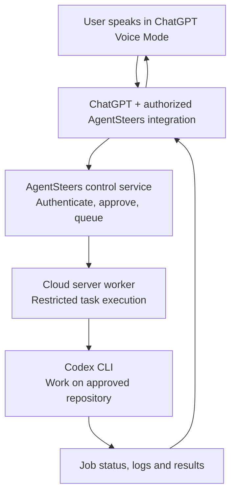

# AgentSteers

AgentSteers is a proposed bridge between **ChatGPT Voice Mode** and **Codex CLI running on the project owner's cloud server**. The user speaks naturally to ChatGPT; an authorized integration submits a scoped job to AgentSteers; AgentSteers dispatches it to an enrolled server worker; the worker invokes Codex CLI in a restricted workspace; and the job status/results return to ChatGPT for a spoken response. AgentSteers is not a standalone chat assistant.

> **Status (2026-11-08):** The end-to-end Voice Mode → integration → server Codex loop is **not yet implemented or verified**. Local mock-worker experiments do not provide live remote execution.

## Proposed architecture

> **Design only:** The diagram describes the intended system. The control service, worker, and integrations are not deployed or operational.

**Scope and safety:** This is the intended architecture, not a working connection. ChatGPT Voice Mode needs a supported, explicitly connected tool/integration to invoke AgentSteers; voice conversation alone does not grant server access. Require scoped authorization, repository/action allowlists, isolated non-root execution, short-lived credentials, cancellation, and redacted audit logs. The worker must return status/errors/results so ChatGPT can explain them. Code changes can be committed/pushed under the owner's authorized workflow, while production deployment, secrets, and financial operations remain separately gated.

## Proposed components

- **ChatGPT Voice Mode + integration:** voice is the user interface; the connected tool translates a permitted conversation request into an authenticated AgentSteers API call.
- **Control service:** authenticate the caller, check scope/approval, queue tasks, and expose job status and results.
- **Server worker:** run on the owner's enrolled cloud host, accept approved jobs only, and invoke Codex CLI with limited privileges in an isolated repository workspace.
- **Feedback loop:** return task output, test summaries, errors, and progress to the integration for ChatGPT to report in conversation.
- **GitHub (optional workflow output):** Codex-produced code changes may result in commits/PRs; GitHub is not the primary control path.

## Security principles

1. **Default deny.** A worker must never execute arbitrary commands or tasks from untrusted input.
2. **Explicit approval.** Every potentially destructive, privileged, or external side effect requires appropriate authorization.
3. **Least privilege and isolation.** Use dedicated non-root identities, restricted filesystem/network access, and short-lived credentials.
4. **No secrets in tasks, logs, or commits.** Store secrets in an approved secret manager, never in source control.
5. **Auditable actions.** Record task identity, approver, scope, timestamps, outcomes, and redacted logs.
6. **Human-controlled deployment.** No automatic production deploys, financial transactions, or access to real payroll data.
7. **Safe cancellation and limits.** Enforce timeouts, resource caps, idempotency, and a kill switch.

## Initial milestones

- [x] Document the intended voice-to-Codex architecture and security boundaries.
- [ ] Define the ChatGPT integration interface and supported invocation mechanism.
- [ ] Specify authenticated task submission, status polling, cancellation and result schemas.
- [ ] Validate local dry-run worker behavior and tests.
- [ ] Implement an isolated server worker with a controlled Codex CLI adapter.
- [ ] Demonstrate end-to-end voice request → approved task → Codex → spoken outcome in a test environment.
- [ ] Complete security review before production server access.

## Relationship to EZ Workbase

EZ Workbase is a separate Frappe-based business application. AgentSteers may eventually help implement and test authorized changes to EZ Workbase, but the two projects should remain isolated. Any payroll or ACH integration must use test data until independently approved and validated.

## Development

Do not treat the mock worker as proof of a working cloud bridge. Develop and test the API contract and permission model locally before enrolling a server or allowing real Codex execution.
