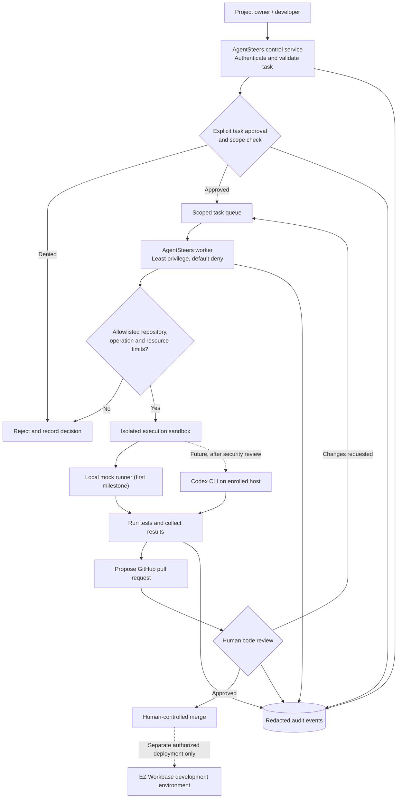

# AgentSteers

AgentSteers is an experimental, open-source orchestration project for **authorized** AI-assisted software engineering tasks. Its proposed architecture includes a control service, a constrained worker, and audited execution of development tasks (potentially using Codex CLI) on an explicitly enrolled host.

> **Status (2026-11-08):** Initial documentation only. No worker, control service, deployment, or remote execution has been verified or enabled.

## Proposed architecture

> **Design only:** The diagram describes the intended system. The control service, worker, and integrations are not deployed or operational.

**Trust boundaries:** The control service does not grant unrestricted shell access. Workers can only process approved, scoped tasks in isolated environments. Codex CLI, remote hosts, merge, and deployment are future integrations, not automatic side effects. EZ Workbase remains a separate project; no production or real payroll access is included.

## Proposed components

- **Control service:** authenticate users, accept scoped tasks, and require explicit authorization before execution.
- **Worker:** poll for approved work, enforce an allowlist of repositories and commands, and run with least privilege in an isolated environment.
- **Review flow:** capture logs and test results; propose code changes through pull requests for human review rather than pushing directly to production.

## Security principles

1. **Default deny.** A worker must never execute arbitrary commands or tasks from untrusted input.
2. **Explicit approval.** Every potentially destructive, privileged, or external side effect requires appropriate authorization.
3. **Least privilege and isolation.** Use dedicated non-root identities, restricted filesystem/network access, and short-lived credentials.
4. **No secrets in tasks, logs, or commits.** Store secrets in an approved secret manager, never in source control.
5. **Auditable actions.** Record task identity, approver, scope, timestamps, outcomes, and redacted logs.
6. **Human-controlled deployment.** No automatic production deploys, financial transactions, or access to real payroll data.
7. **Safe cancellation and limits.** Enforce timeouts, resource caps, idempotency, and a kill switch.

## Initial milestones

- [x] Add project overview and guardrails.
- [ ] Define threat model, authorization policy, and task schema.
- [ ] Implement a local-only, dry-run worker with mocked tasks and tests.
- [ ] Add authenticated task transport and immutable audit events.
- [ ] Demonstrate a sandboxed repository task with a reviewable pull request.
- [ ] Perform security review before any remote server integration.

## Relationship to EZ Workbase

EZ Workbase is a separate Frappe-based business application. AgentSteers may eventually help implement and test authorized changes to EZ Workbase, but the two projects should remain isolated. Any payroll or ACH integration must use test data until independently approved and validated.

## Development

No installation or runtime commands are provided yet. The first implementation should be local-only and use mock tasks, without connecting to a real server.
