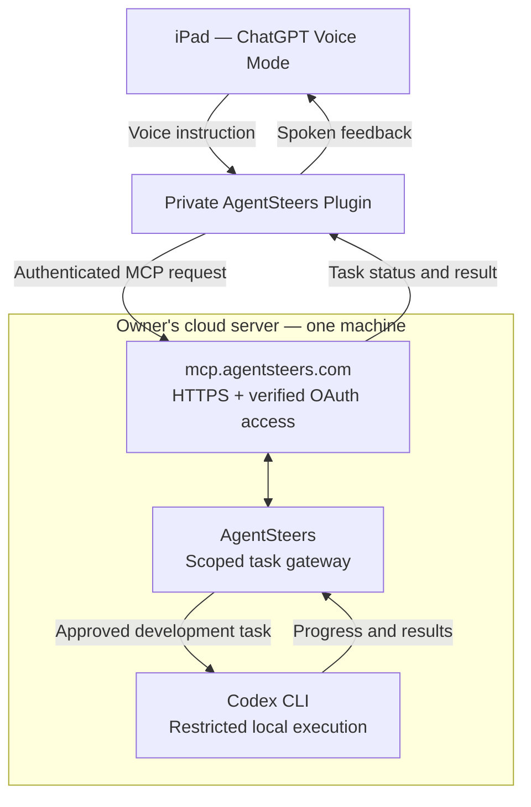

# AgentSteers

**AgentSteers turns ChatGPT Voice Mode on an iPad into a voice control interface for Codex CLI on the owner's cloud server.** The user speaks to ChatGPT, the authorized AgentSteers Plugin relays the task to AgentSteers running on the cloud server, and AgentSteers controls Codex CLI installed **on that same server**. Task progress and results flow back through the Plugin to ChatGPT Voice. AgentSteers is the secure bridge, not another chat assistant.

> **Status (2026-11-08):** The end-to-end Voice Mode → integration → server Codex loop is **not yet implemented or verified**. Local mock-worker experiments do not provide live remote execution.

## Why AgentSteers? (Planned product value)

**Speak to your coding agent, from anywhere — on your own infrastructure.**

AgentSteers is designed for developers who want to issue development requests from **ChatGPT Voice Mode on an iPad** and have a **Codex CLI instance on their own cloud server** carry them out, with progress and results returned to the conversation.

- **Voice-first, not another remote desktop:** ask for a coding task in natural conversation instead of navigating a separate terminal or control dashboard.
- **Self-hosted execution:** keep the development workspace and Codex CLI on a server you control, with AgentSteers as the narrow connection layer.
- **One server, simple path:** the intended `mcp.agentsteers.com` HTTPS/MCP entry point routes directly to AgentSteers and Codex CLI on the same host — no separate relay machine required.
- **Task feedback in conversation:** submit tasks, check progress, retrieve sanitized results, and cancel work without leaving the voice workflow.
- **Controlled automation:** approved repositories and operations, authenticated identity, least-privileged execution, redacted audit trails, and separate approval for dangerous changes.
- **Open-source and extensible by design:** start with Codex CLI; other coding agents may be considered later, but are not supported today.

### How it differs from mobile coding interfaces

Mobile interfaces and remote development tools can already help people manage coding work away from their desks. AgentSteers is **not intended to replace those interfaces**. Its proposed differentiator is the combination of **ordinary ChatGPT voice conversation + private-plugin bridge + self-hosted Codex CLI**, with an auditable permission boundary. This distinction is a **product hypothesis**, not a proven competitive advantage or evidence of demand.

### Example (target experience, not yet implemented)

> On an iPad: “AgentSteers, ask Codex to review the failing tests in EZ Workbase, fix the bug in a safe branch, and tell me what changed.”

AgentSteers would route an approved, scoped task to the server's local Codex CLI and return status, test results, and a reviewable summary to ChatGPT Voice. **This exact voice-to-Codex end-to-end workflow has not been demonstrated yet.** The current private plugin contains guidance only; local MCP mock tools and tests exist, but live plugin binding, remote authentication, cloud deployment, and Codex execution are pending.

## Proposed architecture

> **Target flow, not yet operational:** iPad Voice Mode → AgentSteers Plugin → AgentSteers on the owner's cloud server → Codex CLI on the same server → results back to Voice Mode. The private plugin and local mock MCP components exist, but no live remote plugin/server/Codex link is deployed.

**Scope and safety:** This is the intended architecture, not a working connection. ChatGPT Voice Mode needs a supported, explicitly connected tool/integration to invoke AgentSteers; voice conversation alone does not grant server access. Require scoped authorization, repository/action allowlists, isolated non-root execution, short-lived credentials, cancellation, and redacted audit logs. The worker must return status/errors/results so ChatGPT can explain them. Code changes can be committed/pushed under the owner's authorized workflow, while production deployment, secrets, and financial operations remain separately gated.

## Intended public endpoint

The future MCP endpoint is **`https://mcp.agentsteers.com/mcp`**, pointing to the owner's cloud server where AgentSteers and Codex CLI will run on the same machine. **The domain registration, DNS, HTTPS endpoint, and service deployment are not yet confirmed or verified.** The [deployment guide](deploy/README.md) includes a fail-closed HTTPS prelaunch configuration and security gates. The existing local development HTTP server must never be exposed to the Internet.

## Domain registration and deployment sequence

The intended public address is **`https://mcp.agentsteers.com/mcp`**. The subdomain is an HTTPS entry point **on the same cloud server** as AgentSteers and Codex CLI, **not a separate relay server**. Domain registration was mentioned as in progress by the owner, **not confirmed complete**.

1. **Register and verify domain:** confirm ownership of `agentsteers.com`. **Pending owner confirmation.**
2. **Choose and authorize server:** obtain its public IP or SSH hostname and appropriate access. **Not provided/verified.**
3. **Configure DNS:** point `mcp.agentsteers.com` to the authorized server, after ownership and address are confirmed. **Not performed.**
4. **Provision HTTPS:** configure TLS reverse proxy with the fail-closed prelaunch site (503, no MCP proxy) from [deployment instructions](deploy/README.md). **Not deployed.**
5. **Implement Google sign-in and MCP OAuth:** Google login proves identity; the MCP resource server separately verifies tokens, audience, allowed actions, and job ownership. **Not connected.**
6. **Deploy authenticated AgentSteers MCP service:** enable the four scoped task operations first against mock jobs, with rate limits and audit logs; do not expose the existing unauthenticated loopback prototype. **Not deployed.**
7. **Connect the existing private AgentSteers Plugin:** bind it to the verified HTTPS MCP endpoint, then verify actual ChatGPT Voice Mode tool invocation on iPad. **Not connected or tested.**
8. **Enable same-server Codex CLI under a restricted worker:** only after the preceding security checks and mock end-to-end tests succeed; keep deployment and sensitive actions separately gated. **Not enabled.**

**Existing deliverables:** the private Plugin (instructions only), four local MCP mock tools, protocol tests, HTTP loopback dev gateway, and prelaunch deployment scaffold are in place. **No live voice → plugin → server → Codex flow is claimed.**

## Proposed components

- **ChatGPT Voice Mode + integration:** voice is the user interface; the connected tool translates a permitted conversation request into an authenticated AgentSteers API call.
- **Control service:** authenticate the caller, check scope/approval, queue tasks, and expose job status and results.
- **Same-server Codex:** AgentSteers runs on the owner's cloud server and uses a restricted local worker to invoke Codex CLI installed on that same machine; no separate execution host is required for the initial design.
- **Feedback loop:** return task output, test summaries, errors, and progress to the integration for ChatGPT to report in conversation.
- **GitHub (optional workflow output):** Codex-produced code changes may result in commits/PRs; GitHub is not the primary control path.

## Security principles

1. **Default deny.** A worker must never execute arbitrary commands or tasks from untrusted input.
2. **Explicit approval.** Every potentially destructive, privileged, or external side effect requires appropriate authorization.
3. **Least privilege and isolation.** Use dedicated non-root identities, restricted filesystem/network access, and short-lived credentials.
4. **No secrets in tasks, logs, or commits.** Store secrets in an approved secret manager, never in source control.
5. **Auditable actions.** Record task identity, approver, scope, timestamps, outcomes, and redacted logs.
6. **Human-controlled deployment.** No automatic production deploys, financial transactions, or access to real payroll data.
7. **Safe cancellation and limits.** Enforce timeouts, resource caps, idempotency, and a kill switch.

## Initial milestones

- [x] Document the intended voice-to-Codex architecture and security boundaries.
- [ ] Define the ChatGPT integration interface and supported invocation mechanism.
- [ ] Specify authenticated task submission, status polling, cancellation and result schemas.
- [ ] Validate local dry-run worker behavior and tests.
- [ ] Implement an isolated server worker with a controlled Codex CLI adapter.
- [ ] Demonstrate end-to-end voice request → approved task → Codex → spoken outcome in a test environment.
- [ ] Complete security review before production server access.

## Relationship to EZ Workbase

EZ Workbase is a separate Frappe-based business application. AgentSteers may eventually help implement and test authorized changes to EZ Workbase, but the two projects should remain isolated. Any payroll or ACH integration must use test data until independently approved and validated.

## Development

Do not treat the mock worker as proof of a working cloud bridge. Develop and test the API contract and permission model locally before enrolling a server or allowing real Codex execution.
